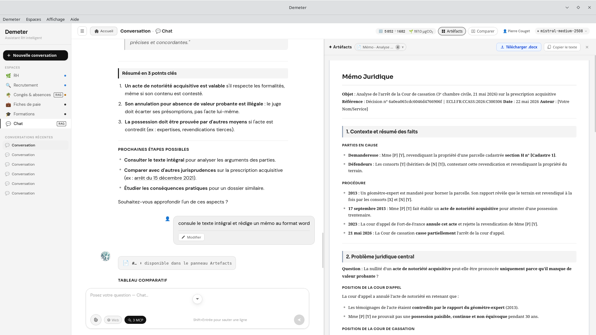

# mcp-judilibre

[](LICENSE)
[](https://www.python.org/)
[](https://modelcontextprotocol.io/)
[](https://www.docker.com/)
[](https://piste.gouv.fr)

---
**VERSION ARCHIVEE, utilisez le serveur MCP Judilibre de demeter-mcp-pack à la place**

**VERSION ARCHIVEE, utilisez le serveur MCP Judilibre de demeter-mcp-pack à la place**

**VERSION ARCHIVEE, utilisez le serveur MCP Judilibre de demeter-mcp-pack à la place**


`mcp-judilibre` expose l'**API JUDILIBRE** de la Cour de cassation sous forme de serveur [MCP](https://modelcontextprotocol.io/) HTTP Streamable. Il rend les décisions de justice françaises directement accessibles à n'importe quel LLM compatible MCP — Claude Desktop, Claude Code, Demeter, ou toute application Tauri/Electron.

JUDILIBRE est le moteur Open Data des décisions de justice françaises : Cour de cassation, cours d'appel et tribunaux judiciaires. Avec **8 outils**, le serveur couvre la recherche plein texte, la consultation de décisions complètes (texte pseudonymisé, zones structurées, rapprochements), l'export par lot en deux modes de pagination, la taxonomie des filtres, les statistiques et l'historique transactionnel.

Il se déploie en une commande, partage ses identifiants PISTE avec `mcp-legifrance`, et peut tourner sur n'importe quelle machine accessible en réseau.

---

## Aperçu



---

## Prérequis

- Python 3.11+
- Un compte sur [piste.gouv.fr](https://piste.gouv.fr) avec accès à l'API JUDILIBRE (gratuit)

> **Note :** Si vous utilisez déjà `mcp-legifrance`, les identifiants PISTE sont les mêmes. Il suffit d'ajouter la souscription à l'API JUDILIBRE dans votre application PISTE existante.

---

## Obtenir les identifiants API

L'API JUDILIBRE est exposée via la plateforme **PISTE** (Plateforme d'Intermédiation des Services pour la Transformation de l'État).

### 1. Créer un compte PISTE

Rendez-vous sur [https://piste.gouv.fr](https://piste.gouv.fr) et cliquez sur **S'inscrire**. L'inscription est gratuite et ouverte à tous.

### 2. Créer une application (ou réutiliser l'existante)

Une fois connecté :

1. Allez dans **Mes applications** → **Nouvelle application** (ou ouvrez votre application existante)
2. Donnez un nom à votre application (ex: `mcp-judilibre`)
3. Sélectionnez l'**environnement Sandbox** pour commencer

### 3. Souscrire à l'API JUDILIBRE

1. Dans le catalogue, recherchez **JUDILIBRE**
2. Cliquez sur **Souscrire** → choisissez votre application
3. La souscription est automatiquement approuvée pour l'environnement Sandbox

### 4. Récupérer les identifiants

Dans votre application PISTE, copiez :
- **Client ID** (`JUDILIBRE_CLIENT_ID`)
- **Client Secret** (`JUDILIBRE_CLIENT_SECRET`)

---

## Installation

### Installation locale (Python)

```bash
git clone https://github.com/ktulu-analog/mcp-judilibre.git
cd mcp-judilibre
python -m venv .venv
source .venv/bin/activate   # Windows : .venv\Scripts\activate
pip install -r requirements.txt
```

### Installation via Docker

```bash
git clone https://github.com/ktulu-analog/mcp-judilibre.git
cd mcp-judilibre
docker build -t mcp-judilibre .
```

---

## Configuration

Copiez `.env.example` en `.env` et renseignez vos identifiants :

```bash
cp .env.example .env
```

```env
JUDILIBRE_CLIENT_ID=votre_client_id
JUDILIBRE_CLIENT_SECRET=votre_client_secret
```

Ou exportez-les directement dans votre shell :

```bash
export JUDILIBRE_CLIENT_ID=votre_client_id
export JUDILIBRE_CLIENT_SECRET=votre_client_secret
```

---

## Démarrage

### En local (Python)

```bash
python server.py
```

Options disponibles :

```
--host   Adresse d'écoute  (défaut : 0.0.0.0)
--port   Port d'écoute     (défaut : 6501)
--path   Chemin MCP        (défaut : /mcp)
```

Exemple sur un port personnalisé :

```bash
python server.py --port 8080
```

### Via Docker

```bash
docker run -p 6501:6501 \
  -e JUDILIBRE_CLIENT_ID=votre_client_id \
  -e JUDILIBRE_CLIENT_SECRET=votre_client_secret \
  mcp-judilibre
```

Le serveur peut tourner sur n'importe quelle machine accessible en réseau. Les clients MCP se connectent alors à `http://adresse-du-serveur:6501/mcp` — le serveur n'a pas besoin d'être sur la même machine que le client.

Le serveur est accessible à `http://localhost:6501/mcp`.

---

## Intégration avec un client MCP

### Claude Desktop

Dans `claude_desktop_config.json` :

```json
{
  "mcpServers": {
    "judilibre": {
      "url": "http://localhost:6501/mcp"
    }
  }
}
```

Pour utiliser les deux serveurs simultanément avec `mcp-legifrance` :

```json
{
  "mcpServers": {
    "legifrance": {
      "url": "http://localhost:6502/mcp"
    },
    "judilibre": {
      "url": "http://localhost:6501/mcp"
    }
  }
}
```

### Claude Code

```bash
claude mcp add judilibre --url http://localhost:6501/mcp
```

### Autre client HTTP Streamable

Tout client supportant la spec MCP 2025-03-26 HTTP Streamable peut se connecter à `http://localhost:6501/mcp`.

---

## Outils disponibles

| Outil | Endpoint | Description |
|---|---|---|
| `judilibre_rechercher` | `GET /search` | Recherche plein texte dans les décisions de justice |
| `judilibre_decision` | `GET /decision` | Texte intégral et métadonnées d'une décision par ID |
| `judilibre_scan` | `GET /scan` | Export par lot, pagination par curseur (`search_after`) |
| `judilibre_export` | `GET /export` | Export par lot, pagination par numéro de lot (`batch`) |
| `judilibre_taxonomie` | `GET /taxonomy` | Référentiel des valeurs valides pour les filtres |
| `judilibre_stats` | `GET /stats` | Statistiques globales et agrégations de la base |
| `judilibre_historique` | `GET /transactionalhistory` | Historique des opérations create/update/delete |
| `judilibre_healthcheck` | `GET /healthcheck` | Vérifie la disponibilité du service API |

### `judilibre_rechercher`

Recherche paginée avec filtres : juridiction (`cc`, `ca`, `tj`), chambre, formation, type de décision, solution, niveau de publication, matière, localisation, plage de dates, opérateur logique (`or`, `and`, `exact`).

### `judilibre_decision`

Récupère une décision complète par son ID JUDILIBRE (obtenu via `judilibre_rechercher`). Retourne le texte pseudonymisé, les zones structurées, les textes appliqués, les rapprochements et les documents associés (communiqués, notes, rapports…).

### `judilibre_scan`

Export par lot pour indexation ou synchronisation d'un corpus. Pagination par **curseur** via `search_after` (style keyset). Version abrégée disponible (`abrege=True`) pour ne pas inclure le texte intégral.

### `judilibre_export`

Export par lot via pagination par **numéro de lot** entier (`lot=0`, `lot=1`…, style offset). Mêmes filtres que `judilibre_scan`. À privilégier quand on veut accéder directement à un lot précis sans avoir à parcourir les précédents.

### `judilibre_taxonomie`

Liste les valeurs valides des filtres. Exemples :
- `judilibre_taxonomie(id="chamber", contexte="cc")` → chambres de la Cour de cassation
- `judilibre_taxonomie(id="solution")` → toutes les solutions possibles
- `judilibre_taxonomie(id="jurisdiction")` → types de juridictions

### `judilibre_stats`

Statistiques mises à jour quotidiennement. Supporte des agrégations multi-axes (ex: `agregations="year,chamber"` pour la répartition par année et par chambre).

### `judilibre_historique`

Flux transactionnel depuis une date ISO-8601 donnée. Retourne les opérations `created`, `updated` et `deleted` pour maintenir un index local synchronisé.

### `judilibre_healthcheck`

Vérifie que l'API JUDILIBRE est opérationnelle. Aucun paramètre requis. Utile pour diagnostiquer les problèmes de connectivité.

---

## Utilisation combinée avec mcp-legifrance

`mcp-judilibre` et `mcp-legifrance` sont complémentaires :

- **JUDILIBRE** → décisions de justice Open Data (Cour de cassation, cours d'appel, tribunaux judiciaires)
- **Légifrance** → textes législatifs et réglementaires, jurisprudence administrative (Conseil d'État, Conseil constitutionnel, CNIL…)

Les deux serveurs peuvent tourner simultanément sur des ports différents (6501 et 6502 par défaut) et être déclarés dans le même fichier de configuration MCP.

---

## Licence

[GNU Affero General Public License v3.0](LICENSE) — © 2026 Pierre COUGET

## Disclaimer

Ce projet n'est pas un projet officiel. C'est la traduction de l'API JUDILIBRE en serveur MCP pour mes propres besoins initialement. Mais autant que ça serve à d'autres.
